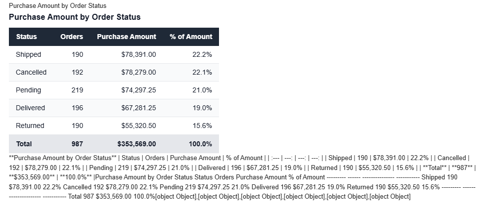

<h1 align="center">Python Automation: Data Cleaning, KPIs and Daily Email Report</h1>

<p align="center"><b>Cleans a messy orders file, calculates KPIs, and emails the numbers to your manager through Gmail — one command, every day.</b></p>

<p align="center">
  
  
  
  
</p>

<p align="center">
  
</p>

## Overview

A Python script that takes a messy orders file, cleans it, calculates daily sales KPIs and emails the numbers to a manager through Gmail — one command, every morning. Daily reporting normally means getting data from a source, cleaning it, transforming it and updating the report; this script automates that whole chain. Built to let a user:

- Turn an uncleaned CSV into an analysis-ready table without manual Excel work
- Get the same KPIs every day, calculated the same way
- Send the report (HTML body plus cleaned CSV attachments) to a manager automatically

```
raw_orders.csv ──► Clean (pandas) ──► KPIs ──► HTML report + CSVs ──► Gmail ──► Manager
```

*Prefer a no-code workflow? See the companion project, `README_n8n_Workflow.md`.*

## Table of Contents

1. [Key Features](#key-features)
2. [Project Files](#project-files)
3. [What Gets Cleaned](#what-gets-cleaned)
4. [KPIs in the Report](#kpis-in-the-report)
5. [Tech Stack](#tech-stack)
6. [Installation & Setup](#installation--setup)
7. [Usage](#usage)
8. [Example Output](#example-output)
9. [How the Script Is Organised](#how-the-script-is-organised)
10. [Troubleshooting](#troubleshooting)
11. [Security Notes](#security-notes)
12. [Learning Notes](#learning-notes)
13. [Repository Structure](#repository-structure)
14. [Roadmap](#roadmap)

## Key Features

| Feature | Description |
|---|---|
| Data cleaning | Fixes text, numbers, dates and times, currency symbols, whitespace, formats, duplicates, nulls and anomalies |
| KPI report | Sales, orders, customers, discounts, cancellation and return rates, top category / city / product |
| Data quality summary | Counts every fix made (duplicates, outliers, invalid emails) so the cleaning is auditable |
| Gmail delivery | Sends the HTML report with `cleaned_orders.csv` and `daily_kpis.csv` attached |
| Locked-file safe | If an output file is open in Excel, saves a timestamped copy instead of crashing |
| Jupyter and terminal | Runs in a notebook or with `python clean_and_report.py --send` |

## Project Files

| File | Purpose |
|---|---|
| `clean_and_report.py` | **Main script.** Cleans data, computes KPIs, builds the report, sends the email. Every line is commented |
| `generate_messy_data.py` | *Optional.* Creates a fake messy dataset to practise on. Not needed with real data |
| `raw_orders.csv` | Input: the uncleaned dataset |
| `cleaned_orders.csv` | Output: the cleaned dataset |
| `daily_kpis.csv` | Output: KPI name and value |
| `daily_report.html` | Output: the report exactly as emailed. Open it in a browser to preview |

## What Gets Cleaned

| Column type | Problems handled |
|---|---|
| **Column names** | Stray spaces and capitals: `" Order Date"` becomes `order_date` |
| **Text** | Extra and inner whitespace (`strip`), mixed casing (`JAIPUR` → `Jaipur`), placeholders such as `N/A`, `-`, `null` turned into real nulls, status spellings merged (`canceled` → `Cancelled`) |
| **Numbers** | `$1,200.50`, `USD 1,200`, `3 units`, `three`, `" 4 "` become numbers; `10%`, `10`, `0.10` all become a 0.10 discount |
| **Dates and times** | 8 date layouts and 3 time layouts merged into one `order_datetime` |
| **Phone and email** | Phones reduced to 10 digits (country code and symbols removed); invalid emails and short phones cleared |
| **Duplicates** | Exact duplicate rows removed, then repeated `order_id` values removed, keeping the most complete row |
| **Nulls** | Missing price or quantity filled with the product median; missing name, city or payment method set to `Unknown`; missing discount set to 0; rows with no `order_id` or no usable order date dropped |
| **Anomalies** | Zero or negative quantity and price cleared; discounts outside 0–90% cleared; price outliers per product removed (IQR); ship dates before order dates cleared |
| **New columns** | `gross_amount`, `discount_amount`, `net_amount` |

*Slash and dash dates such as `05/11/2026` are read day-first (DD/MM/YYYY). Edit `DATE_FORMATS` in the script for month-first data.*

## KPIs in the Report

Calculated at the end of the script from the cleaned data. Cancelled and returned orders are left out of revenue figures.

| KPI | Meaning |
|---|---|
| Orders and net revenue (latest day) | The latest day's orders and sales |
| Revenue vs previous day (%) | Day-over-day change |
| Total orders, total net revenue | All days combined |
| Average order value, units sold | Revenue per order, total quantity |
| Unique customers, total discount given | Distinct customer names, money discounted |
| Cancellation rate, return rate | Share of orders cancelled or returned |
| Average shipping days | Order date to ship date |
| Top category, city, product, payment method | Highest revenue or most frequent |
| Revenue by category, last 7 days | Summary tables in the email |
| Data quality summary | Duplicates removed, outliers fixed, nulls left and so on |

*To add a KPI, add one line to the `kpis` dictionary in `compute_kpis()`.*

## Tech Stack

```
Python
├── pandas            → Data manipulation (like Power Query): reading, cleaning, grouping, null handling
├── numpy             → Fast numerical and mathematical calculations
├── re                → Regular expressions (regex) for pattern-based text cleaning
├── smtplib / ssl     → Secure Gmail delivery (built in)
└── Jupyter Notebook  → Run and inspect the script step by step
```

**Requirements:** Python 3.9+ installed on your computer (or Google Colab) · Jupyter Notebook or VS Code · `pip install pandas numpy jupyter` · a Gmail account with an App Password (only to send the email)

## Installation & Setup

1. Create a folder, for example `Automations`, and put `raw_orders.csv` and `clean_and_report.py` in it.
2. Open Command Prompt in that folder (click the address bar, type `cmd`, press Enter).

```bash
pip install pandas numpy jupyter
jupyter notebook
```

3. In Jupyter choose **New → Python 3** and paste the contents of `clean_and_report.py` into a cell.

*No file paths needed when Jupyter is started from the same folder as the data: the script reads `raw_orders.csv` and writes its outputs next to it. Change `RAW_FILE`, `CLEAN_FILE` and `KPI_FILE` at the top of the script to use other names.*

**Gmail setup (only to send the email)**

1. Turn on 2-Step Verification: [myaccount.google.com/security](https://myaccount.google.com/security).
2. Create an App Password: [myaccount.google.com/apppasswords](https://myaccount.google.com/apppasswords). Gmail rejects your normal password for scripts. A passkey is not needed, and work or school accounts may have App Passwords disabled by an admin.
3. Fill in the config block near the top of `clean_and_report.py`, with each value between the quotes:

```python
SEND_EMAIL = True

GMAIL_USER = "your.address@gmail.com"
GMAIL_APP_PASSWORD = "abcd efgh ijkl mnop"   # 16-character App Password
MANAGER_EMAIL = "manager@company.com"        # several addresses: separate with commas
```

Alternatively leave them empty and set environment variables with the same names. Test with `MANAGER_EMAIL` set to your own address first.

## Usage

```bash
python clean_and_report.py                      # clean + KPIs, no email
python clean_and_report.py --send               # also email the report
python clean_and_report.py --input my_data.csv  # use another file
```

1. Place the raw file in the project folder.
2. Run the script. In Jupyter you can't type `--send`, so set `SEND_EMAIL = True` instead.
3. The log ends with `Report emailed to ...`. If port 465 is blocked, the script retries on port 587 by itself.
4. Compare `cleaned_orders.csv` with `raw_orders.csv` side by side in Excel, or preview `daily_report.html` in a browser.

```python
import pandas as pd
pd.read_csv("cleaned_orders.csv").head()
```

**Practice data:** no real file yet? `python generate_messy_data.py` creates about 1,000 orders with problems injected on purpose (mixed date formats, symbols, duplicates, nulls, outliers). You can also ask an AI assistant for a sample uncleaned data file.

**Run it every day**

- Windows (Task Scheduler): daily task running `python C:\path\to\clean_and_report.py --send`, with "Start in" set to the project folder.
- Linux or macOS (cron): `0 9 * * * cd /path/to/folder && python clean_and_report.py --send`

Before scheduling, set the Gmail details (or environment variables) and make sure the raw data file is refreshed each day.

## Example Output

Results from the included sample dataset (`raw_orders.csv`):

- **1,065 raw rows cleaned to 987** — 64 duplicates removed, 14 rows dropped for a missing ID or unreadable date.
- **33 price outliers, 50 invalid emails, 70 invalid phones and 32 impossible ship dates** were caught and cleared.
- **Net revenue of 219,969.50 across 605 revenue-bearing orders** — average order value 363.59 and 1,809 units sold, excluding cancelled and returned orders.
- **Electronics drives 70.5% of revenue** — 155,181.50 of the total, with Laptop the top product and Pune the top city.
- **Cancellations (19.5%) and returns (19.3%) together affect 38.8% of orders**, with an average of 4.1 days from order to shipping.

## How the Script Is Organised

| Section | Role |
|---|---|
| Config | File names, null-like words, number words, status map, date formats, Gmail settings |
| Helpers | `clean_text`, `parse_number`, `parse_percent`, `parse_dates`, `parse_times`, `null_outliers_iqr` |
| `clean()` | Runs every cleaning step and returns the clean table plus counts for the quality summary |
| `compute_kpis()` | Builds the KPI dictionary and the summary tables |
| `build_html()` | Turns the KPIs into the email body |
| `send_email()` | Sends the email with attachments |
| `main()` | Runs the steps in order. Files locked by Excel are saved under a timestamped name |

## Troubleshooting

| Error | Cause and fix |
|---|---|
| `unrecognized arguments: -f ...json` | Jupyter adds its own argument. The current script ignores it; use the latest file |
| `NameError: name '...' is not defined` on the Gmail lines | A value was typed without quotes: use `GMAIL_USER = "you@gmail.com"` |
| `RuntimeError: Fill in GMAIL_USER ...` | One of the three Gmail settings is empty |
| `PermissionError: ... 'daily_kpis.csv'` | The file is open in Excel. Close it; the script also saves a timestamped copy |
| `SMTPServerDisconnected: Connection unexpectedly closed` | VPN, antivirus or network blocking port 465. The script retries on 587; try another network |
| `Gmail rejected the login` | Use a 16-character App Password, not your normal password |
| `FileNotFoundError: raw_orders.csv` | Start Jupyter from the folder holding the file, or set `RAW_FILE` / `--input` |
| Dates off by a month | Data is month-first: edit `DATE_FORMATS` |

## Security Notes

- Never share the script, a screenshot or a notebook with a real App Password typed in. Prefer environment variables when others can see your code.
- If a password was ever pasted into a chat, email or shared file, change it at [myaccount.google.com/security](https://myaccount.google.com/security) and revoke the App Password.
- Keep credentials out of Git.

## Learning Notes

- Automations can be built with **Python** or with **AI workflows (n8n)**. Typical uses are **daily reporting** (sales today, cancellations today, orders placed today, anomalies in data) and **basic cleaning**.
- In practice this is a **data pipeline**: get data from the source, clean it, transform it, update the report, set up KPIs and alerts for KPIs. Reports are then shown in Power BI, SQL or Excel.
- For Power BI, Power Query already covers a lot of this; use Python when you need more control.
- Python is the right choice when you need full control over cleaning logic; n8n reduces the dependency on coding (see the companion README).

## Repository Structure

```
python-automation
├── clean_and_report.py        ← Main script: clean, KPIs, report, Gmail
├── generate_messy_data.py     ← Optional: creates a messy sample dataset
├── raw_orders.csv             ← Sample uncleaned input
├── screenshot.png             ← Report preview
└── README.md
```

*Generated when the script runs:* `cleaned_orders.csv`, `daily_kpis.csv`, `daily_report.html`.

## Roadmap

- [ ] Add KPIs: count of each order status and customers per city
- [ ] Load the data straight from a database or Google Sheet instead of a CSV
- [ ] Push the cleaned table to Power BI, SQL or Excel for dashboards
- [ ] Alerts when a KPI crosses a threshold

---

## About Me

**Anmol Agarwal**
Business Analyst

[](https://www.linkedin.com/in/anmol-agarwal123/)
[](https://github.com/Anmolagarwal19)
[](mailto:agarwalanmol799@gmail.com)

*If this project was useful, a star on the repo is appreciated — feel free to reach out for feedback, questions, or opportunities.*
